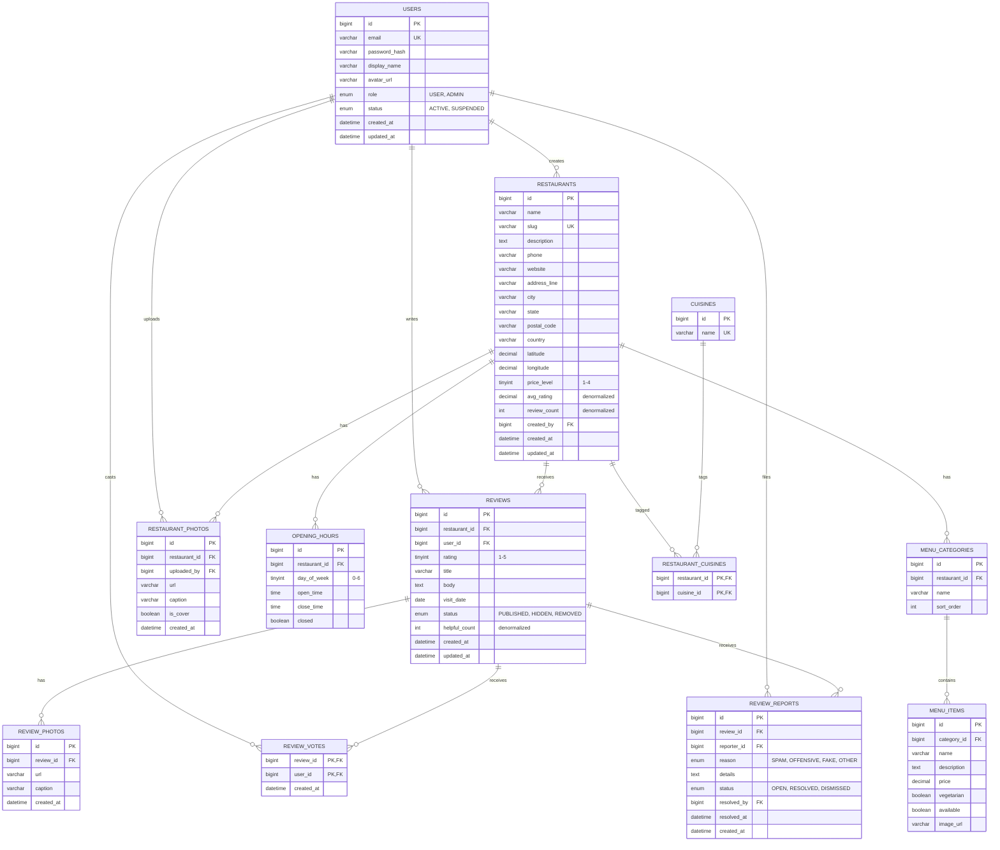

# ER Diagram

Database: **MySQL 8**. This diagram is the reference for the Liquibase changesets in `backend/src/main/resources/db/changelog/`. Any schema change must update this file (see [CLAUDE.md](../CLAUDE.md)).

## Table notes
| Table | Purpose | Notes |
|---|---|---|
| `users` | Accounts | `email` unique; password stored as a BCrypt hash; `status=SUSPENDED` blocks login |
| `restaurants` | Listings | `slug` unique; `avg_rating` / `review_count` updated whenever a published review changes |
| `cuisines` / `restaurant_cuisines` | Many-to-many cuisine tags | Composite PK on the join table |
| `opening_hours` | Weekly schedule | `day_of_week` runs 0=Mon … 6=Sun; `closed=true` ignores the times |
| `menu_categories` / `menu_items` | Menus | Ordered by `sort_order` |
| `reviews` | User reviews | `UNIQUE(restaurant_id, user_id)`; only `PUBLISHED` reviews count toward ratings |
| `review_photos` / `restaurant_photos` | Images | `url` points at a `StorageService` location; one `is_cover` per restaurant |
| `review_votes` | "Helpful" votes | Composite PK, so a user votes once per review; updates `reviews.helpful_count` |
| `review_reports` | Moderation queue | `UNIQUE(review_id, reporter_id)`; `resolved_by` references `users` (an admin) |

## Indexes
- Every FK column is indexed.
- `restaurants(city)`, `restaurants(avg_rating)`
- `reviews(restaurant_id, created_at)`, `reviews(user_id)`
- `review_reports(status, created_at)`

## Future extensions (not in MVP)
- `restaurant_owners` (user ↔ restaurant claim) and `review_replies` for owner responses.
