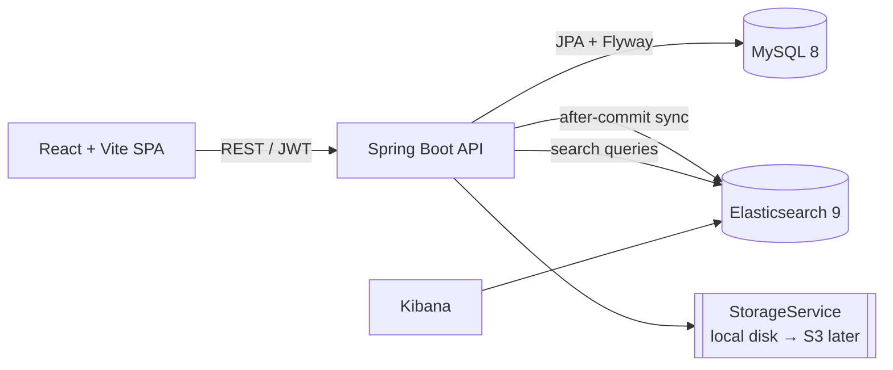

# Project Plan — Restaurant Review Platform

## 1. Vision
A place where diners discover restaurants, read and write honest reviews, see real photos and menus, and find places quickly through fast search. Admins keep the content trustworthy through moderation.

## 2. User roles
| Role | Can do |
|---|---|
| Guest | Search and browse restaurants, menus, photos, reviews |
| User | Everything a guest can, plus write/edit/delete own reviews, upload photos, vote "helpful", report reviews |
| Admin | Everything a user can, plus manage restaurants and cuisines, work the report queue, hide/remove reviews, suspend users, trigger a search reindex |

## 3. MVP scope
- **Core reviews:** auth, restaurant listings, star ratings and reviews, rating aggregation.
- **Photos & menus:** restaurant/review photo uploads, menu categories and items.
- **Search:** Elasticsearch-backed search with filters and geo distance; Kibana for analytics.
- **Moderation:** reports, admin actions, helpful votes.
- **Out of scope for now:** owner claims and replies, notifications, S3, social features.

## 4. Architecture

- MySQL is the source of truth; Elasticsearch is a derived, rebuildable index.
- Layer-based (MVC) backend packages: `controller`, `service`, `repository`, `entities`, `models`, `constants`, `utils`, `config`.

## 5. Data model
See [ER-diagram.md](ER-diagram.md).

## 6. REST API outline
| Area | Endpoints |
|---|---|
| Auth | `POST /api/auth/register`, `POST /api/auth/login`, `GET /api/users/me` |
| Restaurants | `GET/POST /api/restaurants`, `GET/PUT /api/restaurants/{id}`, `GET /api/restaurants/{id}/menu`, `POST /api/restaurants/{id}/photos` |
| Reviews | `GET/POST /api/restaurants/{id}/reviews`, `PUT/DELETE /api/reviews/{id}`, `POST /api/reviews/{id}/photos`, `POST/DELETE /api/reviews/{id}/vote`, `POST /api/reviews/{id}/report` |
| Admin | `GET /api/admin/reports`, `PATCH /api/admin/reports/{id}`, `PATCH /api/admin/users/{id}/status`, `POST /api/admin/search/reindex` |
| Search | `GET /api/search/restaurants?q=&city=&cuisine=&minRating=&priceLevel=&lat=&lon=&radiusKm=&sort=` |

Swagger UI: `/swagger-ui.html`

## 7. Search design (Elasticsearch + Kibana)
- **Index** `restaurants` (`RestaurantDocument`) with these fields: `id`, `name` (text + keyword), `description` (text), `cuisines` (keyword[]), `city` (keyword), `location` (geo_point), `priceLevel` (int), `avgRating` (float), `reviewCount` (int).
- **Sync:** services publish a `RestaurantChangedEvent`, and `IndexSyncListener` re-indexes after the transaction commits. An admin endpoint runs a full reindex.
- **Queries:** multi-match on name/description/cuisines; term filters; a `geo_distance` filter; sort by relevance, rating, review count, or distance.
- **Kibana:** Discover for inspecting documents; dashboards for restaurants by city/cuisine and rating distribution.

## 8. Frontend pages
Home/Search · Restaurant detail (info, hours, menu, photos, reviews) · Write/Edit review · Login · Register · Admin reports queue

## 9. Milestones
| # | Deliverable | Exit criteria |
|---|---|---|
| **M0** | Plan, ER diagram, repo bootstrap, base template | Docs reviewed; template runs with `ddl-auto=validate` |
| **M1** | Auth, restaurant CRUD, reviews + rating aggregation | Users can register, log in, review; averages are correct |
| **M2** | Photos and menus | Validated uploads, gallery, menu view |
| **M3** | Search UI and Kibana | Filters, geo and sort work; index stays in sync |
| **M4** | Moderation and helpful votes | Report → admin action → aggregates and index updated |
| **M5** | Hardening | Testcontainers integration tests, Vitest, pagination, rate limiting, CI |
| Later | Owner claim/reply, S3, notifications | — |

## 10. Non-functional requirements
- **Security:** JWT, BCrypt, role and ownership checks, upload validation, no secrets in the repo.
- **Performance:** paginated lists, denormalized rating counters, ES for search.
- **Quality:** tests with every feature; Flyway-managed schema; docs kept current.

## 11. Open questions for review
1. Should an admin approve new restaurants, or can any user add one?
2. Can users edit a review indefinitely, or only within a time window? Should edit history be kept?
3. Photo limits: maximum per review and maximum file size (proposed: 5 per review, 5 MB each)?
4. Is geo search needed in the MVP, or can city filtering come first?
5. Should Kibana also receive application logs (via Filebeat/Logstash), or only the search index for now?
